<div align="center">

# 🛡️ AgentShield

### **Zero-Leak Secret Defense & Shell Sandbox for Autonomous AI Coding Agents**

[](https://github.com/RitualDev-Lab/AgentShield/stargazers)
[](LICENSE)
[](https://github.com/RitualDev-Lab/AgentShield)
[](https://nodejs.org)
[](tests/)


<br />


[⚡ Quick Start](#-instant-30-second-setup) • [📖 Full Guide](GUIDE.md) • [🛡️ Agent Sandbox](#-1-autonomous-agent-shell-sandbox) • [🐙 GitHub Action](#-3-cicd-security-gate--github-action) • [🤖 Agent Skill](#-ai-agent-skill-integration) • [📋 Compliance](#-4-enterprise-compliance-auditor) • [🏆 Bounties](SECURITY.md) • [👥 Contributors](https://github.com/RitualDev-Lab/AgentShield/graphs/contributors) • [💖 Donate](https://donation.rolenest.in/) • [🌐 Website](https://agentshield.ritualdev.in/)


<br/><br/>

<p align="center">
  
</p>

</div>

---

## 💥 The AI Agent Security Blindspot

Autonomous coding agents (**Claude Code**, **Cursor**, **Windsurf**, **Codex**, **Antigravity**) are routinely granted terminal and file access to inspect codebases and resolve bugs. Without a guardrail, agents frequently:

| Vulnerability Vector | Real-World Agent Behavior | Threat Impact |
| :--- | :--- | :--- |
| **Context Window Leak** | Agent runs `cat .env` or `type .env` to read configs. | Production credentials leak to third-party model inference APIs & chat history. |
| **Accidental Exfiltration** | Agent runs `curl` or shell scripts with exported tokens. | Ephemeral tokens dumped into terminal logs & CI artifacts. |
| **Git Contamination** | Agent writes tests or code with live test credentials. | Secrets committed permanently into Git history and pull requests. |

**AgentShield** acts as a deterministic, local-first zero-leak defense layer that intercepts, audits, and redacts credentials before they ever escape your machine.

---

## ⚡ Instant 30-Second Setup

No account or complicated daemon required. Run instantly with `npx`:

```bash
# 1. Audit any directory or config file for credentials
npx @ritualdev_lab/agentshield scan .env

# 2. Prevent git commits with leaked secrets (installs pre-commit gate)
npx @ritualdev_lab/agentshield hook git-install

# 3. Safely wrap agent bash execution
npx @ritualdev_lab/agentshield exec "cat .env"
```

---

## 🚀 Key Defense Layers

### 🛡️ 1. Autonomous Agent Shell Sandbox
Intercept and sandbox agent terminal execution. If an agent tries to read `.env`, dump shell variables (`printenv`), or send keys to outbound endpoints, AgentShield blocks it on the fly:

```bash
npx @ritualdev_lab/agentshield exec "cat .env"
# 🚨 [AgentShield Sandbox Block] Blocked attempt to read raw .env or private credential file.
# Protected credentials from entering agent LLM context window!
```

### 🚦 2. Git Pre-Commit Leak Shield
Catch leaked credentials before they enter git history. Audits staged diffs automatically:

```bash
# Install once in your repo (native git hook)
npx @ritualdev_lab/agentshield hook git-install

# Or manually audit staged files
npx @ritualdev_lab/agentshield hook check
```

Or using the standard [pre-commit](https://pre-commit.com/) framework (`.pre-commit-config.yaml`):

```yaml
repos:
  - repo: https://github.com/RitualDev-Lab/AgentShield
    rev: v0.1.1
    hooks:
      - id: agentshield
      - id: agentshield-audit
```

### 🐙 3. CI/CD Security Gate & GitHub Action
Block pull requests that introduce exposed credentials into your codebase:

```yaml
name: AgentShield Security Gate
on: [pull_request, push]

jobs:
  secret-audit:
    runs-on: ubuntu-latest
    steps:
      - uses: actions/checkout@v4
        with:
          fetch-depth: 0
      - uses: RitualDev-Lab/AgentShield@v1
        with:
          fail_on_leak: "true"
```

Or run via CLI in any CI container:
```bash
npx @ritualdev_lab/agentshield ci --base origin/main --report security-report.md
```

### 📋 4. Enterprise Compliance Auditor
Audit files and code diffs against industry regulatory controls with ready-to-present scores:

```bash
npx @ritualdev_lab/agentshield compliance .env
```
```text
📋 [ENTERPRISE COMPLIANCE AUDIT] Status: COMPLIANT (Score: 100%)
  ✅ [SOC2] CC6.1: Logical Access Controls & Credential Integrity
  ✅ [PCI-DSS] Req-3.4: Protection of Authentication & Cardholder Tokens
  ✅ [HIPAA] §164.312(a)(1): Technical Safeguards - Access Control
  ✅ [ISO27001] A.8.28: Secure Coding & Secret Management
```

### 🔐 5. Zero-Trust In-Memory Surrogate Injection
Instead of cleartext `.env` keys, AgentShield provides deterministic, collision-resistant surrogate tokens (`[AGENT_SHIELD:ID:hexHash]`). Agents can safely manipulate configurations and inspect outputs without ever seeing the plaintext secret in prompt history, rehydrating values locally when required.


---

---

## 🤖 AI Agent Ecosystem Integrations

AgentShield provides 1-command generators for leading AI coding agent environments:

### Claude Code (`PreToolUse` Hook)
Automatically intercept agent terminal executions before commands touch your environment:
```bash
npx @ritualdev_lab/agentshield init-claude
```
Generates `.claude/settings.json` configured with:
```json
{
  "hooks": {
    "PreToolUse": [
      {
        "matcher": "Bash|Terminal",
        "command": "npx @ritualdev_lab/agentshield exec $COMMAND"
      }
    ]
  }
}
```

### Cursor & Windsurf Rules
```bash
npx @ritualdev_lab/agentshield init-cursor
```
Generates `.cursor/rules.json` with sensitive path boundaries (`.env*`, `*.pem`, `id_rsa*`) and pre-execution command sandboxing.

### Antigravity & Copilot
Plug [`SKILL.md`](SKILL.md) into workspace agent instructions to enforce zero-leak guarantees natively.

---

## ⚡ Comparative Benchmark: AgentShield vs Traditional Scanners

Traditional scanners (`gitleaks`, `trufflehog`) were designed for **post-facto static git repository scanning** (scanning files and commit histories at rest). 

**AgentShield** is designed specifically for **Autonomous Agent Runtime Protection** — intercepting shell commands, scrubbing streaming stdio chunk-by-chunk in sub-milliseconds, and sanitizing LLM prompt inputs before transmission.

| Feature / Metric | AgentShield | GitLeaks | TruffleHog |
| :--- | :---: | :---: | :---: |
| **Primary Domain** | **Agent Runtime & Stdio Interception** | Git History Scanner | Git & Filesystem Scanner |
| **Average Scan Latency** | **< 0.04 ms / scan** | ~ 2 - 5 ms | ~ 10 - 50 ms |
| **Throughput** | **28,000+ operations/sec** | ~ 5,000 ops/sec | ~ 1,200 ops/sec |
| **Streaming Stdio Interception** | ✅ **Native (`createRedactingStream`)** | ❌ (Disk / Git diff only) | ❌ (Disk / Git diff only) |
| **Agent AST Command Sandbox** | ✅ **Native (`exec` / `run`)** | ❌ None | ❌ None |
| **Deterministic Vault Rehydration** | ✅ **Native (`[AGENT_SHIELD:...]`)** | ❌ None | ❌ None |
| **MCP Protocol Filter (JSON-RPC)** | ✅ **Native (`mcp-proxy`)** | ❌ None | ❌ None |
| **Zero Runtime Dependencies** | ✅ **0 deps (Pure Node.js)** | Go binary | Go binary / Python |
| **Git Pre-Commit & CI Gates** | ✅ Built-in | ✅ Built-in | ✅ Built-in |

---

## 🔍 Built-in Secret Detections

AgentShield combines high-performance regular expressions with **Shannon Entropy** to catch both structured keys and arbitrary high-entropy passwords:

- 🤖 **AI Providers**: OpenAI (`sk-proj-*`), Anthropic Claude (`sk-ant-*`), Google Gemini (`AIzaSy*`), Hugging Face (`hf_*`)
- ☁️ **Cloud Infrastructure**: AWS Access Key ID (`AKIA*`), AWS Secret Access Keys
- 💳 **Payments & SaaS**: Stripe Live (`sk_live_*`), Slack Incoming Webhooks
- 🐙 **Version Control**: GitHub Personal Access Tokens (`ghp_*`, `github_pat_*`)
- 🔐 **Cryptography**: PEM / OpenSSH private key blocks, JSON Web Tokens (JWT)
- 📊 **Mathematical Entropy**: High-entropy password detection with false-positive filtering

---

## 🧩 Programmatic TypeScript SDK

Integrate AgentShield directly into your AI workflows, proxy servers, or custom agent frameworks:

```typescript
import { AgentShieldEngine, AgentCommandSandbox, AgentStdioInterceptor } from "@ritualdev_lab/agentshield";

const shield = new AgentShieldEngine();

// Scan and redact unmasked credentials from LLM prompt inputs
const rawPrompt = `Run tests with OPENAI_API_KEY=${mySecretToken}`;
const result = shield.scanAndRedact(rawPrompt);

console.log(result.hasSecrets); // true
console.log(result.sanitizedText);
// "Run tests with OPENAI_API_KEY=[AGENT_SHIELD:OPENAI_API_KEY:c2stcH]"

// Deterministically rehydrate when receiving LLM response back locally
const original = shield.rehydrate(result.sanitizedText);
```

---

- **Live Documentation**: [https://agentshield.ritualdev.in/](https://agentshield.ritualdev.in/)
- **Bug Bounty Program**: Read our [SECURITY.md](SECURITY.md) for rewards ($50 – $500).
- **Contributing**: Check out [CONTRIBUTING.md](CONTRIBUTING.md) to add new secret patterns.
- **Contributors**: Huge thanks to all our open-source [Contributors](https://github.com/RitualDev-Lab/AgentShield/graphs/contributors)!

<p align="center">
  <a href="https://github.com/RitualDev-Lab/AgentShield/graphs/contributors">
    
  </a>
</p>

<div align="center">
  <sub>Maintained with 💜 by <a href="https://github.com/RitualDev-Lab">RitualDev Lab</a> • Licensed under Apache 2.0</sub>
</div>
