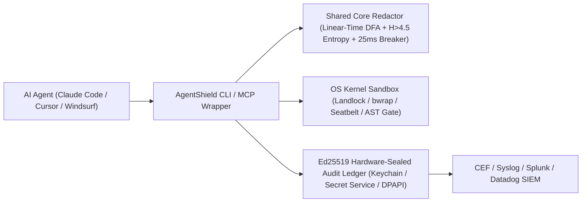

# 02 — AgentShield Architecture

AgentShield defends autonomous coding sessions across four deterministic, sub-millisecond defense layers:

## Defense Layers
1. **Linear-Time Core Redactor (`@ritualdev-lab/agentshield/core-redactor`)**: Zero-dependency DFA-safe regex catalog + Shannon entropy (`H > 4.5`) + hard `25ms` per-chunk circuit-breaker and unified staged-diff AST redaction.
2. **Boundary-Safe Streaming Interceptor**: Handles arbitrary chunk splits, multibyte UTF-8 boundaries, and fail-closed multiline PEM private key windowing.
3. **OS Kernel & Command Sandbox**: Enforces read/write boundaries using Linux Landlock LSM + Bubblewrap (`bwrap`), macOS Seatbelt (`sandbox-exec`), or Windows AST + restricted process boundaries.
4. **Hardware-Sealed Asymmetric Audit Ledger (`src/ledger.ts` & `src/keystore.ts`)**: Signs every sequential hash-chained audit block with an Ed25519 private key sealed in the host OS keystore so compromised local processes cannot forge historical audit records.
