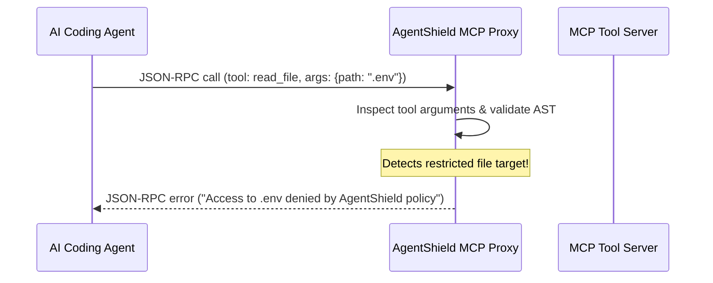

# Model Context Protocol (MCP) Proxy Interceptor 🔌

The **Model Context Protocol (MCP)** enables AI agents to call local and cloud tools via JSON-RPC. Without a security boundary, agents can pass sensitive environment variables or private file contents across MCP tool calls.

---

## 🔒 How AgentShield Protects MCP

AgentShield functions as an inline JSON-RPC proxy sitting between the agent client (Claude Desktop, Cursor, Antigravity) and the MCP server.



---

## ⚙️ Configuration in Claude Desktop / Cursor

Add the AgentShield proxy to your `claude_desktop_config.json`:

```json
{
  "mcpServers": {
    "shielded-filesystem": {
      "command": "npx",
      "args": ["agentshield", "mcp-proxy", "--upstream", "@modelcontextprotocol/server-filesystem", "/workspace"]
    }
  }
}
```

### Protection Guarantees:
1. **Tool Argument Sanitization:** In-flight strings containing secrets are substituted with surrogate tokens before reaching the tool.
2. **Response Scrubbing:** Output returning from MCP servers is audited for leaked cloud keys before entering the LLM prompt window.
